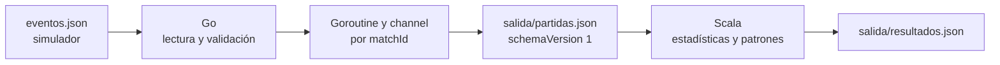

# GameStats

[](https://github.com/JasonM910/GameStats/actions/workflows/ci.yml)

GameStats procesa eventos simulados de Pacman, Buscaminas, Ajedrez y Memoria en dos etapas. Go lee
`eventos.json`, valida cada evento y agrupa los válidos por partida. Scala lee
`salida/partidas.json`, calcula estadísticas y patrones, y escribe
`salida/resultados.json`. Ambos programas terminan después de procesar el archivo;
no son servidores HTTP.

## Arquitectura



1. `main.go` abre el arreglo de eventos. `internal/events` convierte cada objeto
   en `Event`, valida los campos comunes y el `data` del tipo de evento, y
   rechaza los `eventId` duplicados. Los errores de objetos individuales se
   informan en stderr; los eventos válidos siguen adelante.
2. `internal/matches` asigna una goroutine y un channel a cada `matchId`. Solo
   esa goroutine modifica el estado de la partida: juego, jugadores únicos,
   eventos en orden de llegada y marcas de inicio y fin. Si un `matchId`
   aparece con otro juego, el evento se rechaza.
3. `internal/exchange` ordena las partidas por `matchId`, conserva el orden de
   sus eventos y escribe `partidas.json` con `schemaVersion: 1`. Primero escribe
   un archivo temporal y luego lo renombra, para que Scala reciba el archivo
   completo. El JSON versionado permite ejecutar y revisar cada etapa por
   separado.
4. Scala usa `EventLoader` para leer el archivo y comprobar la versión y los
   timestamps. `Analyzer` calcula los resultados generales de los cuatro juegos;
   los analizadores de Pacman y Buscaminas producen métricas y patrones específicos. Para
   reglas temporales ordenan los eventos por `timestamp`. `Main` guarda el
   análisis en `resultados.json`.

La comunicación es un archivo JSON compartido porque cada programa procesa un
lote y termina. Docker Compose espera a que Go finalice correctamente antes de
iniciar Scala. El contrato que comparten ambos módulos se describe a
continuación.

## Contrato de intercambio Go → Scala

Go genera `salida/partidas.json` como JSON UTF-8. Scala lo lee cuando Go ha
terminado correctamente. Los eventos inválidos se informan en stderr de Go y
no aparecen en este archivo. La estructura es:

```json
{
  "schemaVersion": 1,
  "matches": [
    {
      "gameId": "PACMAN",
      "matchId": "P001",
      "players": ["PLAYER01"],
      "events": [
        {
          "eventId": "E001",
          "timestamp": "2026-10-08T17:00:00-06:00",
          "gameId": "PACMAN",
          "gameVersion": "1.0",
          "matchId": "P001",
          "playerId": "PLAYER01",
          "type": "MATCH_STARTED",
          "data": {}
        },
        {
          "eventId": "E003",
          "timestamp": "2026-10-08T17:00:05-06:00",
          "gameId": "PACMAN",
          "gameVersion": "1.0",
          "matchId": "P001",
          "playerId": "PLAYER01",
          "type": "PELLET_EATEN",
          "data": { "points": 10 }
        }
      ]
    }
  ]
}
```

- `schemaVersion` vale `1`; Scala rechaza versiones desconocidas.
- `matches` se ordena por `matchId` y puede estar vacío. Cada partida tiene
  `gameId`, `matchId`, `players` y `events`.
- `players` contiene identificadores únicos en orden de primera aparición.
  `events` conserva el orden de llegada; Scala lo ordena por `timestamp` cuando
  una regla depende del tiempo.
- Cada evento conserva `eventId`, `timestamp`, `gameId`, `gameVersion`,
  `matchId`, `playerId`, `type` y `data`. El `timestamp` usa RFC3339 con zona
  horaria y `data` siempre es un objeto JSON, incluso si está vacío.
- Go comprueba los campos obligatorios de `data` y no permite claves extra. No
  transforma esos valores ni calcula estadísticas. `Started` y `Finished` son
  marcas internas de Go: Scala las infiere de `MATCH_STARTED` y
  `MATCH_FINISHED`.

### Catálogo de eventos

Los nombres de juegos y tipos deben escribirse exactamente como aparecen en
la tabla. `texto` significa cadena no vacía; los enteros deben ser números
JSON, no cadenas. Los booleanos son `true` o `false`, nunca `null`.

| Juego | `type` | Campos obligatorios de `data` |
| --- | --- | --- |
| PACMAN | MATCH_STARTED | Ninguno (`{}`) |
| PACMAN | PELLET_EATEN | `points`: entero ≥ 0 |
| PACMAN | POWER_PELLET_EATEN | `points`: entero ≥ 0; `powerDurationSeconds`: entero > 0 |
| PACMAN | GHOST_EATEN | `ghost`: texto; `points`: entero ≥ 0 |
| PACMAN | FRUIT_EATEN | `fruit`: texto; `points`: entero ≥ 0 |
| PACMAN | LIFE_LOST | `remainingLives`: entero ≥ 0; `ghost`: texto |
| PACMAN | LEVEL_COMPLETED | `level`: entero > 0; `durationSeconds`: entero ≥ 0 |
| PACMAN | MATCH_FINISHED | `result`: texto; `durationSeconds`: entero ≥ 0 |
| MINESWEEPER | MATCH_STARTED | `rows`, `columns`: enteros > 0; `mineCount`: entero ≥ 0; `difficulty`: texto |
| MINESWEEPER | CELL_REVEALED | `row`, `column`, `adjacentMines`: enteros ≥ 0 |
| MINESWEEPER | FLAG_PLACED | `row`, `column`: enteros ≥ 0; `correct`: booleano |
| MINESWEEPER | FLAG_REMOVED | `row`, `column`: enteros ≥ 0 |
| MINESWEEPER | MINE_TRIGGERED | `row`, `column`: enteros ≥ 0 |
| MINESWEEPER | BOARD_COMPLETED | `difficulty`: texto; `durationSeconds`: entero ≥ 0 |
| MINESWEEPER | MATCH_FINISHED | `result`: texto; `durationSeconds`: entero ≥ 0 |
| CHESS | MATCH_STARTED | `side`: `WHITE` o `BLACK`; un evento por jugador |
| CHESS | MOVE_PLAYED | `ply`: entero > 0; `piece`: `PAWN`, `KNIGHT`, `BISHOP`, `ROOK`, `QUEEN` o `KING`; `from`, `to`: casillas `a1`–`h8` diferentes; `thinkTimeSeconds`: entero ≥ 0 |
| CHESS | PIECE_CAPTURED | `ply`: entero > 0; `capturedPiece`: una pieza de la lista anterior |
| CHESS | CHECK_GIVEN | `ply`: entero > 0 |
| CHESS | CHECKMATE | `ply`: entero > 0 |
| CHESS | MATCH_FINISHED | `result`: `WIN`, `LOSS` o `DRAW`; `durationSeconds`: entero ≥ 0; un evento por jugador |
| MEMORY | MATCH_STARTED | `rows`, `columns`, `pairCount`, `timeLimitSeconds`: enteros > 0 |
| MEMORY | CARD_FLIPPED | `cardId`, `symbol`: texto; `turn`: entero > 0 |
| MEMORY | PAIR_MATCHED | `firstCardId`, `secondCardId`: textos diferentes; `turn`: entero > 0 |
| MEMORY | PAIR_MISMATCHED | `firstCardId`, `secondCardId`: textos diferentes; `turn`: entero > 0 |
| MEMORY | TIME_EXPIRED | `pairsFound`: entero ≥ 0 |
| MEMORY | MATCH_FINISHED | `result`: `WIN` o `LOSS`; `durationSeconds`: entero ≥ 0 |

La validación comprueba la forma de cada evento. No verifica reglas entre
eventos, como si una casilla pertenece al tablero de esa partida, si una
jugada de ajedrez es legal o si dos cartas reveladas forman realmente un par.
En Ajedrez, `ply` identifica cada medio movimiento: 1 es la primera jugada de
blancas, 2 la respuesta de negras, etc. Los eventos de captura, jaque y mate
usan el `ply` de su jugada. En Memoria, `turn` agrupa las dos cartas reveladas
en un intento y el evento que indica si formaron pareja.

`eventos.json` contiene 88 eventos de 9 partidas: 2 de Pacman, 3 de
Buscaminas, 2 de Ajedrez y 2 de Memoria. Go conserva los dos participantes
de cada partida de Ajedrez en `players` y procesa las partidas de Memoria como
el resto de juegos.

## Requisitos y ejecución local

Para ejecutar sin Docker se necesitan Go, Java 21 y sbt. Desde la raíz del
proyecto, en PowerShell:

```powershell
go run .
cd scala
sbt test
sbt "run ../salida/partidas.json"
cd ..
Get-Content -Raw salida/resultados.json
```

Go acepta `-input ruta/al/eventos.json` y `-output ruta/al/partidas.json`. Scala
acepta como primer argumento la ruta del archivo preparado por Go. También se
pueden definir `GAMESTATS_INPUT` y `GAMESTATS_OUTPUT`; sin una ruta de salida,
Scala escribe `resultados.json` junto al archivo de entrada.

Los eventos inválidos se informan en la salida de error de Go y se excluyen de
`partidas.json`. Go procesa las partidas mediante goroutines y channels. El
formato común, las reglas de validación y el catálogo están en la sección
[Contrato de intercambio Go → Scala](#contrato-de-intercambio-go--scala).

## Despliegue local con Docker

El entorno de despliegue elegido para esta versión es un equipo Windows con
Docker Desktop, contenedores Linux y Docker Compose. El proyecto se ejecuta
como una tarea por lote; los resultados quedan en la carpeta `salida/` del
equipo. Desde una copia del repositorio, iniciar Docker Desktop y ejecutar en
PowerShell desde la raíz:

```powershell
New-Item -ItemType Directory -Force salida | Out-Null
docker compose up --build
$resultado = Get-Content -Raw salida/resultados.json | ConvertFrom-Json
$resultado.matches.Count
$resultado.patterns.Count
```

[compose.yaml](compose.yaml) construye las imágenes de Go y Scala, ejecuta Go
primero y espera a que termine correctamente antes de iniciar Scala. Ambos
contenedores comparten la carpeta `salida/` del proyecto. La construcción de la
imagen Scala ejecuta sus pruebas. La ejecución termina con dos archivos:
`salida/partidas.json` y `salida/resultados.json`. Con los datos de ejemplo se
esperan 9 partidas y 3 patrones; verificar esos números confirma que ambas
etapas corrieron. Para retirar los contenedores terminados:

```powershell
docker compose down
```

Los Dockerfiles son [Dockerfile](Dockerfile) para Go y
[scala/Dockerfile](scala/Dockerfile) para Scala. Cada imagen también se puede
construir por separado:

```powershell
docker build -t gamestats-go .
docker build -t gamestats-scala ./scala
```

Este es el deployment funcional definido para la entrega. El pipeline de
GitHub Actions compila, prueba y entrega artefactos descargables; no publica el
sistema en un servidor remoto. Para repetir el despliegue local después de
actualizar el código, ejecutar de nuevo `docker compose up --build`.

## Resultados de Scala

`resultados.json` contiene `schemaVersion`, `players`, `matches`, `games`,
`metrics` y `patterns`. Scala convierte el JSON de Go en `GameEvent`, `MatchData`
y `PartidasFile`; rechaza versiones de esquema desconocidas y timestamps
inválidos. El análisis agrupa por jugador y juego con `groupBy`, transforma
colecciones con `filter`, `map` y `flatMap`, y agrega valores con `foldLeft` y
`reduce`.

| Sección | Cálculo |
| --- | --- |
| `players` | Partidas finalizadas, victorias, derrotas y `winrate = victorias / partidas finalizadas × 100`. Si no hay partidas finalizadas, el porcentaje es 0. |
| `matches` | Juego, jugadores, cantidad de eventos, resultado y duración de cada partida. Sin `MATCH_FINISHED`, el resultado es `UNFINISHED` y la duración es 0. |
| `games` | Partidas y eventos por juego; duración media de las partidas finalizadas. Si ninguna terminó, el promedio es 0. |

Las métricas específicas se calculan por jugador y partida:

| Juego | Métrica | Cálculo |
| --- | --- | --- |
| Pacman | `totalPoints` | Suma de `points` en `PELLET_EATEN`, `POWER_PELLET_EATEN`, `GHOST_EATEN` y `FRUIT_EATEN`. |
| Pacman | `pointsPerMinute` | `totalPoints / durationSeconds × 60`; se emite solo si `MATCH_FINISHED` tiene duración mayor que 0. |
| Buscaminas | `flagAccuracyPercent` | Banderas con `correct: true` divididas entre todas las `FLAG_PLACED`, por 100; se emite solo si hubo banderas. |
| Buscaminas | `cellsRevealed` | Cantidad de eventos `CELL_REVEALED`. |

Los patrones se buscan por jugador dentro de cada partida, ordenando los eventos
por `timestamp`:

| Patrón | Regla |
| --- | --- |
| `POWER_PELLET_COMBO` | En Pacman, después de `POWER_PELLET_EATEN` se comen al menos dos fantasmas dentro de `powerDurationSeconds`. |
| `COMEBACK` | En Pacman, ocurre `LIFE_LOST` y posteriormente `MATCH_FINISHED` con resultado `WIN`. |
| `FLAG_CORRECTED` | En Buscaminas, se coloca una bandera incorrecta y luego se retira de la misma casilla. |

Cada patrón incluye los identificadores del evento inicial y final. Un juego
sin analizador específico conserva las estadísticas generales, pero no produce
métricas ni patrones propios.

La parte de Scala todavía tiene analizadores específicos solo para Pacman y
Buscaminas. Ajedrez y Memoria aparecen en las estadísticas generales de
`players`, `matches` y `games`; sus métricas y patrones específicos quedan
pendientes en el módulo Scala.

## Pruebas e integración continua

```powershell
go test ./...
cd scala
sbt test
```

En Windows, `go test -race ./...` requiere CGO y un compilador C. El flujo de
[GitHub Actions](.github/workflows/ci.yml) ejecuta pruebas Go con detector de
carreras, `go vet`, compila Go, construye las dos imágenes Docker y ejecuta las
pruebas Scala durante su construcción. Luego procesa el archivo de ejemplo de
Go a Scala y verifica la estructura de `resultados.json`. Publica como artefacto
la imagen de Go y los dos JSON de ejemplo; no despliega servicios.
