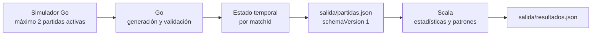
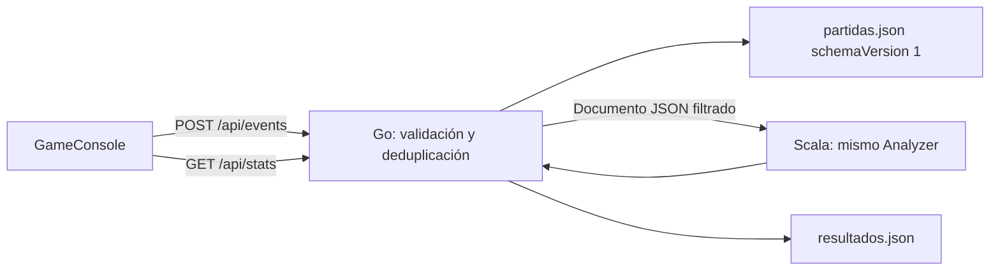

# GameStats

[](https://github.com/JasonM910/GameStats/actions/workflows/ci.yml)

GameStats procesa partidas de Pacman, Buscaminas, Ajedrez y Memoria en dos etapas. En el modo por lotes original, Go genera eventos gradualmente para un máximo de dos partidas activas, valida cada evento y agrupa los válidos por partida. Al terminar escribe `salida/partidas.json`. Scala lee ese archivo, calcula estadísticas y patrones, y escribe `salida/resultados.json`. Ambos programas terminan después de completar el lote. Ahora existe además un modo HTTP opcional para GameConsole, descrito al final; el procesamiento por archivos y sus formatos permanecen disponibles.

## Arquitectura



1. `internal/simulator` crea partidas de los cuatro juegos con una semilla aleatoria. Dos goroutines toman partidas de una cola y emiten eventos por un channel, uno a uno y con una pausa configurable. `main.go` valida cada `Event` con `internal/events` y rechaza identificadores duplicados. Los errores se informan en stderr.
2. `internal/matches` actualiza el estado de cada `matchId` conforme llegan los eventos simulados: juego, jugadores únicos, eventos en orden de llegada y marcas de inicio y fin. El consumidor del channel es el único que modifica estos estados. Si un `matchId` aparece con otro juego, el evento se rechaza. Para reproducir `-input`, el procesador anterior sigue usando una goroutine y un channel por partida.
3. `internal/exchange` ordena las partidas por `matchId`, conserva el orden de
   sus eventos y escribe `partidas.json` con `schemaVersion: 1`. Primero escribe
   un archivo temporal y luego lo renombra, para que Scala reciba el archivo
   completo. El JSON versionado permite ejecutar y revisar cada etapa por
   separado.
4. Scala usa `EventLoader` para leer el archivo y comprobar la versión y los
   timestamps. `Analyzer` calcula los resultados generales de los cuatro juegos;
   cada juego tiene un analizador que produce métricas y patrones específicos. Para
   reglas temporales ordenan los eventos por `timestamp`. `Main` guarda el
   análisis en `resultados.json`.

En el modo por lotes la comunicación sigue siendo un archivo JSON compartido. El Docker Compose de este repositorio espera a que Go finalice correctamente antes de iniciar Scala. El contrato que comparten ambos módulos se describe a continuación.

## Contrato de intercambio Go → Scala

Go genera `salida/partidas.json` como JSON UTF-8. Scala lo lee cuando Go ha
terminado correctamente. Los eventos inválidos se informan en stderr de Go y
no aparecen en este archivo. La estructura es:

```json
{
  "schemaVersion": 1,
  "matches": [
    {
      "gameId": "PACMAN",
      "matchId": "P001",
      "players": ["PLAYER01"],
      "events": [
        {
          "eventId": "E001",
          "timestamp": "2026-10-08T17:00:00-06:00",
          "gameId": "PACMAN",
          "gameVersion": "1.0",
          "matchId": "P001",
          "playerId": "PLAYER01",
          "type": "MATCH_STARTED",
          "data": {}
        },
        {
          "eventId": "E003",
          "timestamp": "2026-10-08T17:00:05-06:00",
          "gameId": "PACMAN",
          "gameVersion": "1.0",
          "matchId": "P001",
          "playerId": "PLAYER01",
          "type": "PELLET_EATEN",
          "data": { "points": 10 }
        }
      ]
    }
  ]
}
```

- `schemaVersion` vale `1`; Scala rechaza versiones desconocidas.
- `matches` se ordena por `matchId` y puede estar vacío. Cada partida tiene
  `gameId`, `matchId`, `players` y `events`.
- `players` contiene identificadores únicos en orden de primera aparición.
  `events` conserva el orden de llegada; Scala lo ordena por `timestamp` cuando
  una regla depende del tiempo.
- Cada evento conserva `eventId`, `timestamp`, `gameId`, `gameVersion`,
  `matchId`, `playerId`, `type` y `data`. El `timestamp` usa RFC3339 con zona
  horaria y `data` siempre es un objeto JSON, incluso si está vacío.
- Go comprueba los campos obligatorios de `data` y no permite claves extra. No
  transforma esos valores ni calcula estadísticas. `Started` y `Finished` son
  marcas internas de Go: Scala las infiere de `MATCH_STARTED` y
  `MATCH_FINISHED`.

### Catálogo de eventos

Los nombres de juegos y tipos deben escribirse exactamente como aparecen en
la tabla. `texto` significa cadena no vacía; los enteros deben ser números
JSON, no cadenas. Los booleanos son `true` o `false`, nunca `null`.

| Juego | `type` | Campos obligatorios de `data` |
| --- | --- | --- |
| PACMAN | MATCH_STARTED | Ninguno (`{}`) |
| PACMAN | PELLET_EATEN | `points`: entero ≥ 0 |
| PACMAN | POWER_PELLET_EATEN | `points`: entero ≥ 0; `powerDurationSeconds`: entero > 0 |
| PACMAN | GHOST_EATEN | `ghost`: texto; `points`: entero ≥ 0 |
| PACMAN | FRUIT_EATEN | `fruit`: texto; `points`: entero ≥ 0 |
| PACMAN | LIFE_LOST | `remainingLives`: entero ≥ 0; `ghost`: texto |
| PACMAN | LEVEL_COMPLETED | `level`: entero > 0; `durationSeconds`: entero ≥ 0 |
| PACMAN | MATCH_FINISHED | `result`: texto; `durationSeconds`: entero ≥ 0 |
| MINESWEEPER | MATCH_STARTED | `rows`, `columns`: enteros > 0; `mineCount`: entero ≥ 0; `difficulty`: texto |
| MINESWEEPER | CELL_REVEALED | `row`, `column`, `adjacentMines`: enteros ≥ 0 |
| MINESWEEPER | FLAG_PLACED | `row`, `column`: enteros ≥ 0; `correct`: booleano |
| MINESWEEPER | FLAG_REMOVED | `row`, `column`: enteros ≥ 0 |
| MINESWEEPER | MINE_TRIGGERED | `row`, `column`: enteros ≥ 0 |
| MINESWEEPER | BOARD_COMPLETED | `difficulty`: texto; `durationSeconds`: entero ≥ 0 |
| MINESWEEPER | MATCH_FINISHED | `result`: texto; `durationSeconds`: entero ≥ 0 |
| CHESS | MATCH_STARTED | `side`: `WHITE` o `BLACK`; un evento por jugador |
| CHESS | MOVE_PLAYED | `ply`: entero > 0; `piece`: `PAWN`, `KNIGHT`, `BISHOP`, `ROOK`, `QUEEN` o `KING`; `from`, `to`: casillas `a1`–`h8` diferentes; `thinkTimeSeconds`: entero ≥ 0 |
| CHESS | PIECE_CAPTURED | `ply`: entero > 0; `capturedPiece`: una pieza de la lista anterior |
| CHESS | CHECK_GIVEN | `ply`: entero > 0 |
| CHESS | CHECKMATE | `ply`: entero > 0 |
| CHESS | MATCH_FINISHED | `result`: `WIN`, `LOSS` o `DRAW`; `durationSeconds`: entero ≥ 0; un evento por jugador |
| MEMORY | MATCH_STARTED | `rows`, `columns`, `pairCount`, `timeLimitSeconds`: enteros > 0 |
| MEMORY | CARD_FLIPPED | `cardId`, `symbol`: texto; `turn`: entero > 0 |
| MEMORY | PAIR_MATCHED | `firstCardId`, `secondCardId`: textos diferentes; `turn`: entero > 0 |
| MEMORY | PAIR_MISMATCHED | `firstCardId`, `secondCardId`: textos diferentes; `turn`: entero > 0 |
| MEMORY | TIME_EXPIRED | `pairsFound`: entero ≥ 0 |
| MEMORY | MATCH_FINISHED | `result`: `WIN` o `LOSS`; `durationSeconds`: entero ≥ 0 |

La validación comprueba la forma de cada evento. No verifica reglas entre
eventos, como si una casilla pertenece al tablero de esa partida, si una
jugada de ajedrez es legal o si dos cartas reveladas forman realmente un par.
En Ajedrez, `ply` identifica cada medio movimiento: 1 es la primera jugada de
blancas, 2 la respuesta de negras, etc. Los eventos de captura, jaque y mate
usan el `ply` de su jugada. En Memoria, `turn` agrupa las dos cartas reveladas
en un intento y el evento que indica si formaron pareja.

`eventos.json` queda como muestra histórica y caso de prueba opcional. La ejecución normal genera partidas nuevas sin leerlo. El simulador conserva dos participantes en Ajedrez y un participante por partida en los demás juegos.

### Simulación de partidas en Go

Por defecto, `go run .` genera ocho partidas: dos de cada juego, en orden aleatorio. Hay **como máximo dos partidas activas simultáneamente**. Cada trabajador genera los eventos de su partida paso a paso, espera `100ms` entre eventos y libera su puesto al terminar; entonces empieza la siguiente. El progreso aparece en consola. Los `matchId` y `eventId` son únicos dentro de la ejecución. `-seed` permite repetir las decisiones aleatorias; sin esa opción se usa una semilla nueva.

- Pacman genera puntos, frutas, poderes y pérdidas de vida; gana al completar el nivel o pierde al agotar las vidas.
- Buscaminas coloca tres minas en un tablero de 4×4, calcula pistas según sus posiciones, revela casillas seguras y termina al limpiar el tablero o activar una mina.
- Ajedrez elige aleatoriamente entre tres líneas de jugadas legales (mate del pastor, mate del loco o tablas por acuerdo). Genera inicio y resultado para ambos jugadores.
- Memoria mezcla tres parejas reales de cartas, voltea dos cartas por intento y emite `PAIR_MATCHED` o `PAIR_MISMATCHED` según sus símbolos. Termina al encontrar todos los pares o al agotarse el tiempo.

Go entrega a Scala un **archivo completo** cuando todas las partidas simuladas terminan. La generación es gradual dentro de Go; Scala mantiene por ahora el procesamiento por lote.

## Requisitos y ejecución local

Para ejecutar sin Docker se necesitan Go, Java 21 y sbt. Desde la raíz del
proyecto, en PowerShell:

```powershell
go run .
cd scala
sbt test
sbt "run ../salida/partidas.json"
cd ..
Get-Content -Raw salida/resultados.json
```

Go acepta `-matches 8`, `-seed 42`, `-interval 100ms` y `-output ruta/al/partidas.json`. `-input ruta/al/eventos.json` es una opción para reproducir datos existentes y desactiva el simulador. Scala
acepta como primer argumento la ruta del archivo preparado por Go. También se
pueden definir `GAMESTATS_INPUT` y `GAMESTATS_OUTPUT`; sin una ruta de salida,
Scala escribe `resultados.json` junto al archivo de entrada.

Los eventos inválidos se informan en la salida de error de Go y se excluyen de
`partidas.json`. Go procesa las partidas mediante goroutines y channels. El
formato común, las reglas de validación y el catálogo están en la sección
[Contrato de intercambio Go → Scala](#contrato-de-intercambio-go--scala).

## Despliegue local con Docker

El entorno de despliegue elegido para esta versión es un equipo Windows con
Docker Desktop, contenedores Linux y Docker Compose. El proyecto se ejecuta
como una tarea por lote; los resultados quedan en la carpeta `salida/` del
equipo. Desde una copia del repositorio, iniciar Docker Desktop y ejecutar en
PowerShell desde la raíz:

```powershell
New-Item -ItemType Directory -Force salida | Out-Null
docker compose up --build
$resultado = Get-Content -Raw salida/resultados.json | ConvertFrom-Json
$resultado.matches.Count
$resultado.patterns.Count
```

[compose.yaml](compose.yaml) construye las imágenes de Go y Scala, ejecuta Go
primero y espera a que termine correctamente antes de iniciar Scala. Ambos
contenedores comparten la carpeta `salida/` del proyecto. La construcción de la
imagen Scala ejecuta sus pruebas. La ejecución termina con dos archivos:
`salida/partidas.json` y `salida/resultados.json`. Con la configuración normal se esperan ocho partidas, dos por juego. Las métricas y los patrones varían con las decisiones aleatorias. Para retirar los contenedores terminados:

```powershell
docker compose down
```

Los Dockerfiles son [Dockerfile](Dockerfile) para Go y
[scala/Dockerfile](scala/Dockerfile) para Scala. Cada imagen también se puede
construir por separado:

```powershell
docker build -t gamestats-go .
docker build -t gamestats-scala ./scala
```

Este es el deployment funcional definido para la entrega. El pipeline de
GitHub Actions compila, prueba y entrega artefactos descargables; no publica el
sistema en un servidor remoto. Para repetir el despliegue local después de
actualizar el código, ejecutar de nuevo `docker compose up --build`.

## Resultados de Scala

`resultados.json` contiene `schemaVersion`, `players`, `matches`, `games`,
`metrics` y `patterns`. Scala convierte el JSON de Go en `GameEvent`, `MatchData`
y `PartidasFile`; rechaza versiones de esquema desconocidas y timestamps
inválidos. El análisis agrupa por jugador y juego con `groupBy`, transforma
colecciones con `filter`, `map` y `flatMap`, y agrega valores con `foldLeft` y
`reduce`.

| Sección | Cálculo |
| --- | --- |
| `players` | Partidas completas por jugador, victorias, derrotas, empates (`draws`) y `winrate = victorias / partidas completas × 100`. Un empate cuenta como partida, pero no como victoria o derrota. Una partida incompleta no suma resultados a ningún jugador. Si no hay resultados, el porcentaje es 0. |
| `matches` | Juego, jugadores, cantidad de eventos, duración y `results` con el resultado de cada jugador. `result` vale `DECIDED` cuando hay resultados distintos, `DRAW` si todos empatan, o el resultado común si coinciden. Si falta el resultado de algún participante, vale `UNFINISHED` y la duración es 0. |
| `games` | Partidas y eventos por juego; duración media de las partidas finalizadas. Si ninguna terminó, el promedio es 0. |

Las métricas específicas se calculan por jugador y partida:

| Juego | Métrica | Cálculo |
| --- | --- | --- |
| Pacman | `totalPoints` | Suma de `points` en `PELLET_EATEN`, `POWER_PELLET_EATEN`, `GHOST_EATEN` y `FRUIT_EATEN`. |
| Pacman | `pointsPerMinute` | `totalPoints / durationSeconds × 60`; se emite solo si `MATCH_FINISHED` tiene duración mayor que 0. |
| Buscaminas | `flagAccuracyPercent` | Banderas con `correct: true` divididas entre todas las `FLAG_PLACED`, por 100; se emite solo si hubo banderas. |
| Buscaminas | `cellsRevealed` | Cantidad de eventos `CELL_REVEALED`. |
| Ajedrez | `movesPlayed` | Número de eventos `MOVE_PLAYED` del jugador. |
| Ajedrez | `avgThinkTimeSeconds` | Promedio de `thinkTimeSeconds` en sus jugadas; se omite si no hay jugadas. |
| Ajedrez | `capturedMaterial` | Suma de valores de piezas capturadas: peón 1, caballo/alfil 3, torre 5, dama 9. |
| Ajedrez | `checksGiven` | Número de eventos `CHECK_GIVEN` del jugador. |
| Memoria | `pairsFound` | Número de eventos `PAIR_MATCHED` del jugador. |
| Memoria | `matchAccuracyPercent` | Parejas acertadas entre todos los intentos (`PAIR_MATCHED` y `PAIR_MISMATCHED`), por 100; se omite si no hubo intentos. |
| Memoria | `timeUsedPercent` | `durationSeconds / timeLimitSeconds × 100`; se emite cuando hay inicio y fin con límite positivo. |

Los patrones se buscan por jugador dentro de cada partida, ordenando los eventos
por `timestamp`:

| Patrón | Regla |
| --- | --- |
| `POWER_PELLET_COMBO` | En Pacman, después de `POWER_PELLET_EATEN` se comen al menos dos fantasmas dentro de `powerDurationSeconds`. |
| `COMEBACK` | En Pacman, ocurre `LIFE_LOST` y posteriormente `MATCH_FINISHED` con resultado `WIN`. |
| `FLAG_CORRECTED` | En Buscaminas, se coloca una bandera incorrecta y luego se retira de la misma casilla. |
| `CAPTURE_CHECKMATE` | En Ajedrez, un jugador captura una pieza, da jaque y hace jaque mate en ese orden durante el mismo `ply`. |
| `MATCH_STREAK` | En Memoria, un jugador encuentra dos o más parejas en intentos consecutivos sin fallar entre ellas. |
| `REMEMBERED_CARD` | En Memoria, se forma una pareja usando una carta vista antes en un intento fallido. |

Cada patrón incluye los identificadores del evento inicial y final. Un juego
sin analizador específico conserva las estadísticas generales, pero no produce
métricas ni patrones propios.

Los cuatro juegos producen estadísticas generales y métricas propias. La simulación puede producir resultados y patrones diferentes en cada ejecución; con `-seed` se puede repetir una ejecución concreta.

## Pruebas e integración continua

```powershell
go test ./...
cd scala
sbt test
```

En Windows, `go test -race ./...` requiere CGO y un compilador C. El flujo de
[GitHub Actions](.github/workflows/ci.yml) ejecuta pruebas Go con detector de
carreras, `go vet`, compila Go, construye las dos imágenes Docker y ejecuta las
pruebas Scala durante su construcción. Luego ejecuta una simulación reproducible
de Go a Scala y verifica la estructura de `resultados.json`. Publica como artefacto
la imagen de Go y los dos JSON generados; no despliega servicios.

## API HTTP opcional para GameConsole

El modo por archivos anterior sigue siendo el predeterminado. La API agrega
transporte a la validación Go y al `Analyzer` Scala existentes; no introduce una
base de datos ni un segundo cálculo de estadísticas. Los adaptadores HTTP usan
las bibliotecas estándar de [Go](https://pkg.go.dev/net/http) y
[Java 21](https://docs.oracle.com/en/java/javase/21/docs/api/jdk.httpserver/com/sun/net/httpserver/HttpServer.html).



Ejecución local en terminales separadas:

```powershell
# Desde GameStats/scala
sbt "runMain AnalysisServer"

# Desde GameStats
go run . -serve
```

Go escucha en 8080 y Scala en 8081. Desde el repositorio hermano `GameConsole`,
`docker compose up --build -d --wait` inicia Nginx, Go y Scala y publica la consola
en http://localhost:8088. El Compose de este repositorio continúa siendo el del
flujo por lotes y puede usarse independientemente.

| Método y endpoint | Comportamiento |
| --- | --- |
| `POST /api/events` | Arreglo JSON de 1 a 500 eventos; máximo 1 MiB. Valida el catálogo original y la secuencia de inicio/final por jugador. Guarda todo el lote antes de confirmar. |
| `GET /api/stats` | Analiza el histórico actual con Scala y devuelve `AnalysisResult` sin alterar el esquema original. |
| `GET /api/stats?gameId=PACMAN&playerId=PLAYER_ONE` | Selecciona partidas por juego y/o jugador antes de analizarlas; conserva ambos jugadores de Ajedrez para no alterar sus resultados. |
| `GET /health` | Comprueba disponibilidad de Go y del servicio Scala. Devuelve 503 si falta Scala. |

Una recepción correcta responde HTTP 200:

```json
{"status":"accepted","eventIds":["E001","E002"]}
```

Reenviar el mismo `eventId` y contenido es idempotente, incluso después de
reiniciar Go. Otro contenido con ese ID, cambiar de juego dentro del mismo
`matchId`, repetir inicio/final con otro ID o agregar eventos tras el resultado
del jugador produce 409. Las repeticiones idénticas se reconocen antes de
validar la secuencia para permitir reintentar también partidas terminadas.
El almacenamiento y las peticiones concurrentes se coordinan con un mutex;
no ejecutar dos instancias escritoras sobre el mismo archivo.

Errores estructurados:

```json
{"error":{"code":"invalid_events","message":"falta eventId o está vacío"}}
```

Los códigos HTTP incluyen 400 (JSON/datos/filtros inválidos), 404 (ruta),
405 (método), 409 (conflicto), 413 (tamaño), 415 (Content-Type), 500
(persistencia), 502 (respuesta inválida de Scala) y 503 (Scala no disponible).
La validación de datos reutiliza `Event.Validate`; las comprobaciones de
secuencia son adicionales para la API y no cambian la tolerancia del lector
histórico. No se validan en el servidor las reglas completas del tablero.

### Persistencia y coexistencia con archivos

La API usa por defecto `salida/api/partidas.json`, separado de
`salida/partidas.json` del simulador. Recupera los eventos al arrancar y conserva
los identificadores originales. Cada escritura publica un documento completo
mediante archivo temporal y renombrado, utilizando `internal/exchange`.
Un histórico inválido impide iniciar la API; no se borra ni sustituye.

El análisis ocurre al consultar estadísticas, sobre una instantánea del
histórico. Una consulta sin filtros publica `resultados.json` junto a ese
histórico; las consultas filtradas no sobrescriben los resultados globales.
Si Scala falla, los eventos permanecen almacenados y la consulta informa el
error; no se presentan resultados antiguos como si fueran actuales.

Los archivos de la API pueden procesarse con el CLI Scala original:

```powershell
cd scala
sbt "run ../salida/api/partidas.json"
```

Para incorporar un archivo histórico, elegir **una copia** de un documento
`partidas.json` generado por Go como `GAMESTATS_DATA` antes de arrancar. Los
arreglos históricos como `eventos.json` se convierten con el flujo original:

```powershell
go run . -input eventos.json -output salida/importacion/partidas.json
go run . -serve -data salida/importacion/partidas.json
```

No ejecutar el simulador escribiendo sobre el mismo archivo que está usando
la API. La versión de esquema y el catálogo originales no cambian. Compose
integrado guarda el histórico en el volumen `gamestats-data`; reiniciar o
recrear contenedores lo conserva. Hacer respaldo de ambos JSON del volumen
para trasladar el historial a otro equipo.

### Variables del modo HTTP

| Variable | Valor predeterminado | Uso |
| --- | --- | --- |
| `GAMESTATS_LISTEN` | `:8080` | Dirección de Go; también `-listen`. |
| `GAMESTATS_DATA` | `salida/api/partidas.json` | Histórico de la API; también `-data`. |
| `GAMESTATS_ANALYZER_URL` | `http://localhost:8081/analyze` | Servicio interno Scala; también `-analyzer-url`. |
| `GAMESTATS_CORS_ORIGIN` | Vacío | Origen adicional permitido para acceso directo desde navegador. El proxy de GameConsole evita necesitar CORS. |
| `GAMESTATS_ANALYZER_PORT` | `8081` | Puerto de `AnalysisServer`. |

La imagen Scala ejecuta `java -cp /app/lib/* Main`; sin argumentos mantiene el
procesamiento de archivos y con `--serve` inicia HTTP. Se construye con sbt y
las dependencias actuales, y su runtime contiene Java 21, sin sbt. No se añade
un framework HTTP. `go run . -healthcheck` comprueba Go/Scala en el puerto 8080
y permite verificar disponibilidad desde el contenedor Go sin instalar curl.

### Pruebas y CI del modo HTTP

`go test ./...` incluye validación, atomicidad de lotes, idempotencia,
concurrencia, restauración del histórico, filtros y fallos del analizador.
`sbt test` compara la salida HTTP con el análisis del mismo documento por
archivo y mantiene las pruebas originales. El workflow existente además inicia
ambas imágenes como servicios, envía eventos del simulador dos veces, consulta
métricas, reinicia Go y repite la validación de persistencia con
`demo/check_api.py`.

El repositorio hermano GameConsole añade un smoke test que genera eventos desde
las clases de sus cuatro juegos, los entrega a Go y comprueba resultados Scala,
incluyendo casillas reveladas, precisión de banderas y correcciones en Buscaminas.
Su workflow recibe la rama/commit compatible de este repositorio mediante
`GAMESTATS_REF`; coordinar ambas ramas antes de ejecutarlo en GitHub.

El deployment definido continúa siendo Docker Compose; los workflows prueban
y entregan artefactos. No se publica automáticamente un servicio remoto sin
un destino y credenciales configurados. La API actual es una integración local
sin cuentas ni autenticación; para publicarla se debe configurar el acceso y
HTTPS del entorno de despliegue.
